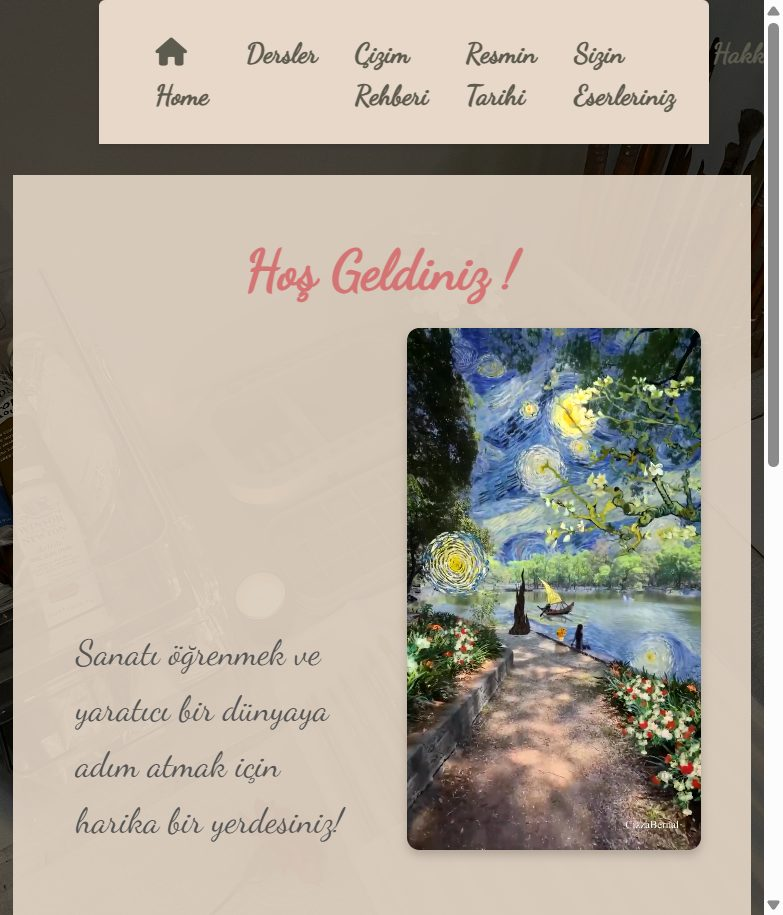
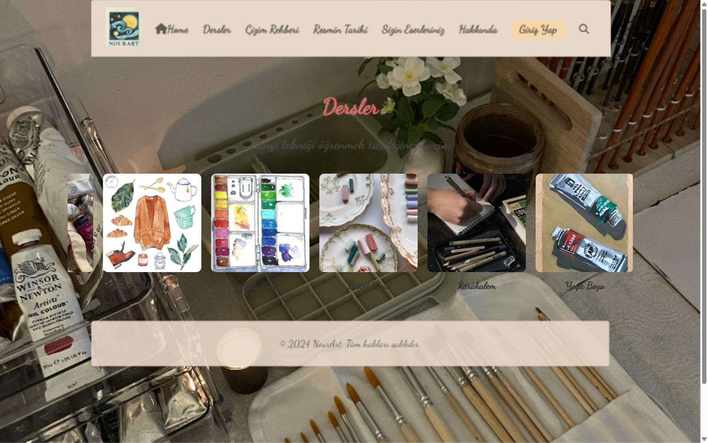
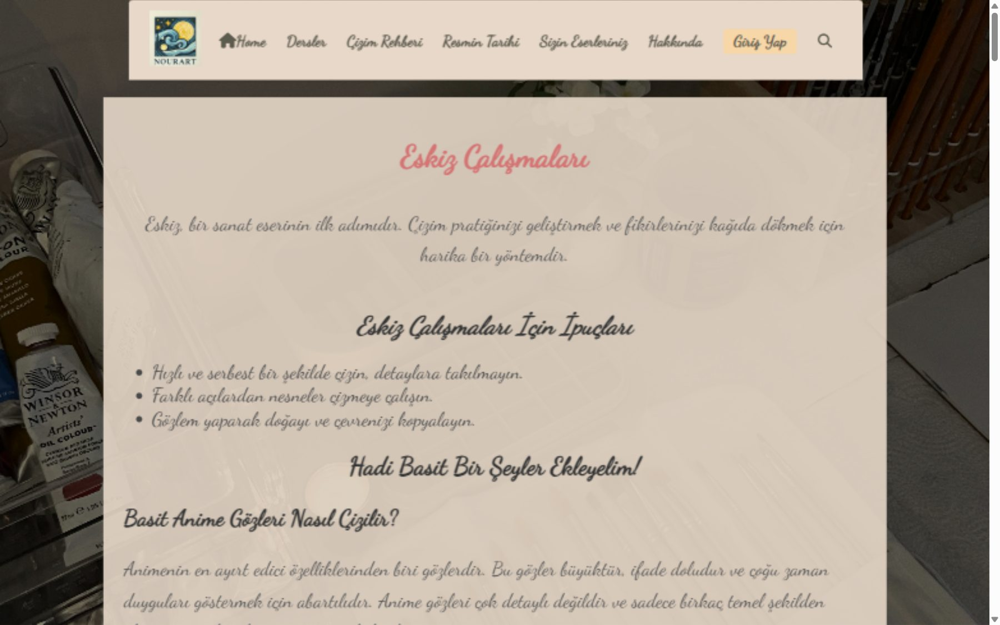
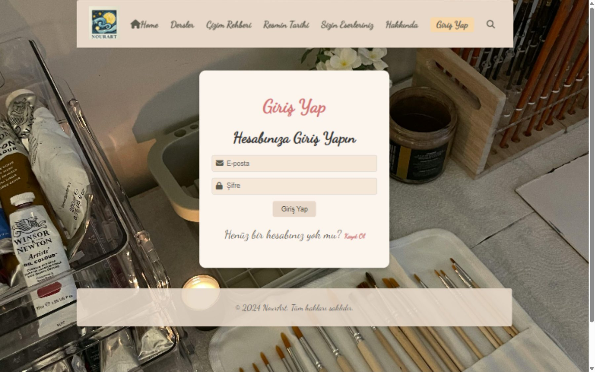
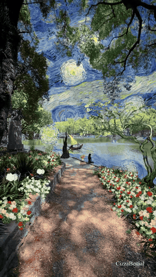

# NourArt

A Turkish-language art-learning site built with plain HTML and CSS — a landing page,
a course catalogue, an anime-drawing step-by-step tutorial, and login/register
screens.

`HTML` · `CSS` · `PHP` · `MySQL` · **6 pages** · **12 KB stylesheet** · **1 tiny script** · **CSS-only slider**

> **Scope note.** The front end is framework-free: the slider, the dropdown and the
> hover effects are `@keyframes` and `transform`. The only script in the repository
> is in `welcome.html`, to carry the user's name across pages. The forms post to
> `register.php` and `login.php`, which store users in MySQL with
> `password_hash()` and prepared statements — run `database.sql`, copy
> `config.example.php` to `config.php`, and it works on XAMPP.

## What I built

- **A CSS-only front end** — the auto-scrolling course slider, the dropdown menu and
  the hover effects are all `@keyframes` and `transform`. No framework, no build step.
- **A six-page structure** — home, course catalogue, a seven-step drawing tutorial,
  login, register, and a post-login welcome page.
- **A working registration backend** — PHP handlers with password hashing, prepared
  statements and an escaped error path, plus the MySQL schema for the user table.
- **A 12 KB stylesheet** driving every page, written before I knew what a design
  system was called.

| Home | Course catalogue |
|---|---|
|  |  |

| Drawing tutorial | Login |
|---|---|
|  |  |

The home page plays a looping Van Gogh background video. GitHub does not autoplay
video in a README, so the same clip is shown as an animated GIF:



## What's in here

| Page | What it does |
|---|---|
| `index.html` | Home: hero, intro, "Keşfet" link, Van Gogh background video |
| `dersler.html` | Course catalogue with an auto-scrolling image slider |
| `eskizler.html` | Tutorial page: how to draw an anime eye, 7 photographed steps |
| `giris.html` / `kayit.html` | Login / register forms (UI only, no backend) |
| `NourArtCSS/styles.css` | Single stylesheet, ~12 KB, everything |

## Notes on the implementation

**One stylesheet, no preprocessor.** `NourArtCSS/styles.css` holds the whole design
system: a fixed background image, a translucent navbar with a hover reveal on the
dropdown, a CSS-only infinite slider (`@keyframes` + `transform`), and form styling.
There is no JS at all — the dropdown, the slider and the image hovers are pure CSS.

**The slider is duplicated markup, not a JS carousel.** Each course is written twice
in `dersler.html` so the animation can loop seamlessly. It works and needs zero
script, but adding a course means editing two places. A JS-free fix would be to
repeat the list with a `<template>`; the honest answer is that this is the trade-off
I accepted at the time.

**External assets are CDN-only:** Font Awesome 6.7.1 (with SRI hash) and Google Fonts
(Dancing Script). No local copies of the libraries, so the page needs a connection to
render the icons and typeface.

**Turkish text encoding.** All files are UTF-8 and the `charset` meta is set on every
page; an earlier version was saved in a legacy encoding and rendered `Yağlı` as
`Ya�l�`. That was the bug that taught me to check the encoding before the CSS.

**Known limitations**

- Login and register are static forms — no validation, no storage, no session. Wiring
  them to a backend was out of scope.
- Course detail pages (`karakalem.html`, `yagli-boya.html`, `akrilik-boya.html`,
  `suluboya.html`, `pastel-boya.html`, `resmin-tarihi.html`) were planned but never
  written; the catalogue links to them and they currently point at `#`.
- The tutorial page originally embedded a `eskizler.mp4` clip; that file was never
  saved, so the video block was removed rather than left pointing at nothing.
- Not responsive below ~1000 px: the navbar and slider were built for desktop.
- Unused images remain in `NourArtCSS/` from the planning stage.

## How to run

No install, no build:

```bash
git clone https://github.com/<username>/NourArt.git
cd nourart
```

Then open `index.html` in a browser. Or serve it, which is closer to how it was
tested:

```bash
python -m http.server 8000     # http://localhost:8000/
```

## Licence

MIT for the code — see [LICENSE](LICENSE). The artwork and photographs in this
repository are mine and are **not** covered by the MIT grant; please don't reuse them.
